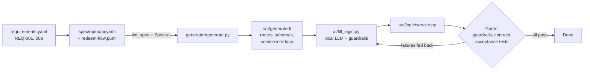

# Spec-to-Code Lab

A small, measurable experiment on one question: **does a specification-driven, AI-assisted
workflow develop software faster and more consistently than a code-first workflow, and is
the result easier to change?**

The subject is a tiny offline-payment API (issue, look up and redeem vouchers). It is built
twice under the same requirements and judged by the same tests:

- **A. Spec-driven:** OpenAPI spec → deterministic code generator → AI fills in the business
  logic inside a closed loop with guardrails → automated quality gates.
- **B. Code-first:** the same requirements in prose, implemented directly with an AI assistant.

## How the spec-driven pipeline works



| Gate | Checks | Command |
|---|---|---|
| 1. Spec rules | House rules (operationIds, linked requirements, shared error schema, closed object schemas, valid examples) plus standard OpenAPI rules in CI | `python gates/lint_spec.py` |
| 2. Generated code | `src/generated/` is exactly what the generator produces from the current spec, so it can't be hand-edited or go stale | `python gates/check_generated.py` |
| 3. Traceability | Every requirement is linked to an operation and at least one test; writes a matrix to `gates/out/traceability.md` | `python gates/trace_check.py` |
| 4. Guardrails | The logic implements the generated interface, imports only allow-listed modules, and returns only status codes declared in the spec | `python gates/check_guardrails.py` |
| 5. Acceptance and contract | 40 black-box tests; every response is also validated against the spec at runtime | `python -m pytest tests` |
| 6. API fuzzing (CI) | Schemathesis generates requests from the spec and checks the responses | see `.github/workflows/ci.yml` |

## Quick start

```bash
python3 -m venv .venv && source .venv/bin/activate
pip install -r requirements.txt

python generator/generate.py        # regenerate src/generated/ from the spec
python gates/lint_spec.py && python gates/check_generated.py && python gates/trace_check.py
python -m pytest tooling_tests      # tests for the pipeline itself (21)
python -m pytest tests              # acceptance tests: 13 pass on the empty stub, 40 when done
```

Fill in the business logic with a local model ([Ollama](https://ollama.com)):

```bash
ollama pull qwen2.5-coder:7b
python ai/fill_logic.py --attempts 3     # every attempt is logged to experiment/ai_attempts.csv
```

Run the same tests against the code-first version: `TARGET=codefirst python -m pytest tests`.

## The experiment

See [`experiment/PROTOCOL.md`](experiment/PROTOCOL.md) for conditions, task order, metrics and
threats to validity, and [`experiment/tasks.md`](experiment/tasks.md) for the tasks: **T1**
builds the API, **T2** adds a change request (voucher expiry) to measure how easy each version
is to evolve. `python experiment/measure.py T1 A` computes the metrics from git tags.

| Metric | Meaning |
|---|---|
| Lead time | Minutes from start to all tests passing |
| Defects at first run | Acceptance tests failing the first time the work was considered done |
| Rework | Lines changed between the first attempt and the final version |
| Hand-written lines | Code written by the developer or the AI, generated code excluded |
| Consistency | Responses that break the agreed contract |
| AI attempts | Rounds of the closed loop before all gates passed |

## Observations while building the pipeline

These came up while building and checking the pipeline, before the experiment itself:

1. **The generator does part of the work for free.** With empty business logic, 13 of the 40
   acceptance tests already pass, because all input validation is generated from the spec.
2. **Writing tests exposed a gap in the requirements.** It was unclear whether a *rejected*
   redemption "uses up" its idempotency key. The test forced a decision, which was then
   written into both the requirements and the spec.
3. **Fairness needs a prose contract.** Without field names and error codes in the
   requirements, a code-first developer could not pass the tests at all.
4. **The generator does not check formats** such as `date-time`. This showed up when
   preparing the change request, and became an explicit guardrail rule. Generating format
   checks is a natural next improvement.

## What has been verified

- Generator, all gates, the tooling tests and the acceptance tests were run locally, including
  deliberate violations to confirm each gate fails when it should.
- The acceptance tests pass against a reference implementation that is **not** included,
  so the experiment starts from an empty stub.
- The change request (T2) was applied end to end in a scratch copy: spec change, regeneration
  and logic; all 49 tests and all gates passed.
- The AI loop was tested with a simulated model that first returns code breaking the spec and
  then a fixed version; the guardrail failure was fed back and the second attempt passed.
- **Not yet verified:** the Spectral and Schemathesis CI steps and a run with a real Ollama model.

## Project layout

```
requirements/requirements.yaml   requirements REQ-001..008 and the prose interface
spec/openapi.yaml                machine-readable spec (OpenAPI 3.1)
spec/redeem-flow.puml            PlantUML interaction flow for redemption
generator/                       deterministic generator and Jinja2 templates
src/generated/                   generated code (never edit by hand)
src/logic/service.py             business logic for condition A (empty stub)
code_first/app.py                implementation for condition B (empty)
ai/                              guardrail rules and the closed AI loop
gates/                           quality gates
tests/                           acceptance and contract tests, linked to requirements
tooling_tests/                   tests for the generator, gates and AI loop
experiment/                      protocol, tasks, change-request tests, log and metrics
```
